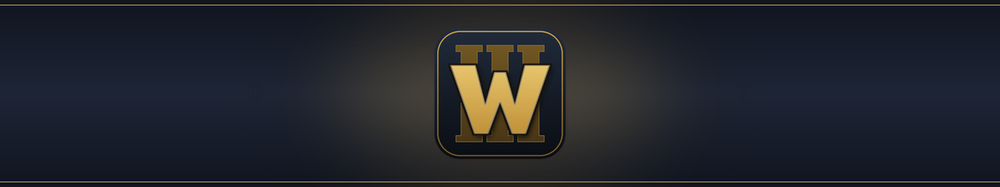
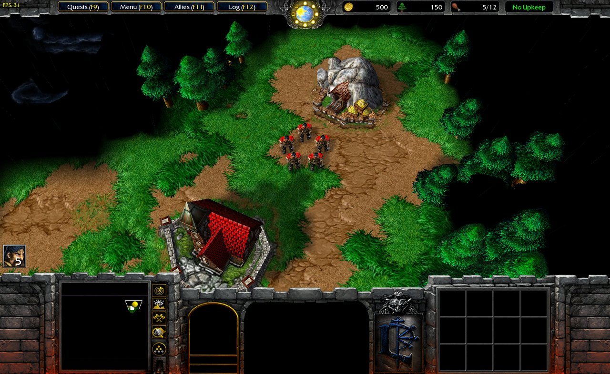

<div align="center">

# Warsmash Android

Continuation of Retera's [Warsmash](https://github.com/Retera/WarsmashModEngine) engine for W3, with full native Android support.

[](LICENSE)


</div>

## About

The aim is to play W3 on phones and tablets with classic graphics at a steady 30 FPS on weaker devices and up to 120 FPS on faster ones.

> [!IMPORTANT]
> No game files are included or distributed. The engine reads them from your own legally obtained copy of W3.

Supported game versions: **1.31 and newer, including Reforged**, played with Classic graphics. The engine reads the CASC install, or game files extracted from it (for example with the Reforged Extractor toolkit). Tested with 1.31.1, 1.32.10 (extracted files) and 3.0.1. Older releases that ship MPQ archives (1.29 and earlier) are not supported.

## Status

Current version: **v0.2.15**

- **Custom games:** work end-to-end.
- **Campaigns:** Reign of Chaos and The Frozen Throne can be completed to the end. Tweaking required.
- **Controls:** full touch screen control, with S Pen support.
- **Launcher:** built from your own game data, with Campaign, Custom Game, Load Game, Options and Help; the same launcher on Android and desktop.
- **Cinematics:** campaign intro, opening and ending movies play from the game data (desktop: Windows x64).
- **Save and load**, also from the main menu.

## Technical specification

- **Languages:** Java 17 (engine, Android launcher, tools); JASS2 scripts run by the engine's own interpreter; GLSL / GLSL ES shaders.
- **Libraries:** libGDX 1.14.2 (with `gdx-freetype`), LWJGL 2 on desktop, ANTLR 4, Gson, Guava, Apache Commons Compress and IO; FFmpeg (JavaCPP) for movies on desktop.

## Screenshots



## Running on desktop

Requires JDK 17.

Without a map argument the program opens on its launcher, where you choose the game data folder. To start the engine directly instead:

1. Copy `core/assets/warsmash.ini` to `core/assets/warsmash.local.ini`.
2. Point `[DataSources]` at your game install:

   ```ini
   [DataSources]
   Count=3
   Type00=CASC
   Path00="C:\Path\To\Game"
   Prefixes00=war3.w3mod,war3.w3mod\_deprecated.w3mod,war3.w3mod\_locales\enus.w3mod
   Type01=Folder
   Path01="..\..\resources"
   Type02=Folder
   Path02="."
   ```

3. Run:

   ```bash
   ./gradlew desktop:runGame -Pargs="-window -ini warsmash.local.ini"
   ```

## Running on Android

Requires Android 8.0 or newer and your own copy of the game data on the device.

1. Build and install the app:

   ```bash
   ./gradlew android:installDebug
   ```

2. Copy the game data to the device: an installed game folder (CASC) or extracted files. The [Reforged Extractor toolkit](https://github.com/nikoltu/W3-Android-prep-tool) prepares the data from your own copy for this engine. Files copied into the app's own folder (`Android/data/com.etheller.warsmash.android/files/data`) are found by themselves.
3. On first start, choose that folder in the **Game data folder** screen with **Choose folder** and tap **Continue**. A folder outside the app's own folder needs the **All files access** permission, which the screen asks for.
4. Later starts go straight to the game. To pick another folder, hold the app icon and choose **Game data**.

## Credits

- [Retera](https://github.com/Retera) for Warsmash and everyone who contributed to it
- [libGDX](https://libgdx.com/)

## License

[GNU AGPL v3.0](LICENSE), same as upstream.
